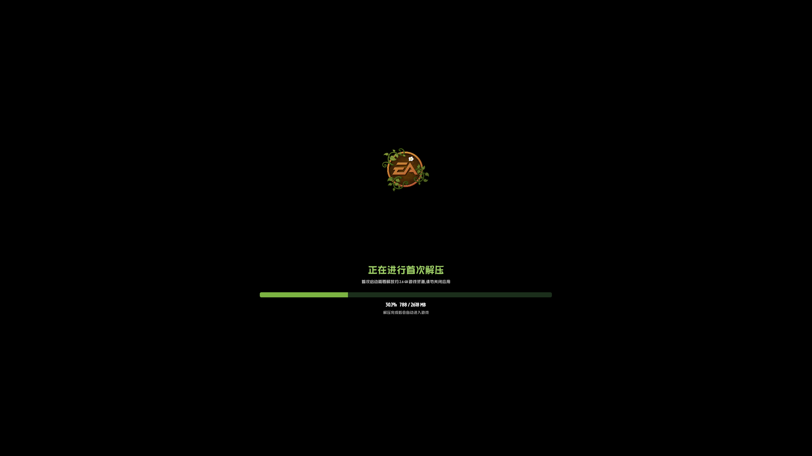

# 植物大战僵尸2 1.7.5 失落之城 · WSA 直装版

> **基于《植物大战僵尸2》中文版 1.7.5（失落之城，包名 `com.popcap.pvz2cthd`）制作。**
>
> 启动器/资源方案来自 [DreamMoonCai/Pvz2Tool](https://github.com/DreamMoonCai/Pvz2Tool)；
> 首次解压画面参考《植物大战僵尸2》中文版 4.2.4；
> ASTC 解码基于 [google/astc-codec](https://github.com/google/astc-codec)。

一个面向 Windows Subsystem for Android（WSA）/ 普通 Android 的单文件直装版：
安装后第一次启动会显示“正在进行首次解压”，把约 2.6 GB 资源释放到
`Android/data/com.popcap.pvz2cthd/files/`，完成后自动进入游戏。

没有启动器、没有工具箱，也不需要装第二个 APK。

## 截图

| 首次解压 | 游戏加载 |
|---|---|
|  |  |

## 特性

- **程序名**：植物大战僵尸2
- **单文件直装**：资源以分卷形式内置在 APK 中，首次启动自动解压
- **首次解压界面**：黑底 + EA logo + 绿色进度条 + `PvZ2 Regular By Beast and MF.ttf`
- **跳过“服务器通讯中”**：`AndroidHttpProxy.GetNetworkStatus()` 固定返回 `0`
- **WSA 纹理兼容层**：`libRestart.so` 作为 GL shim
  - RGBA4444 → RGBA8888
  - ETC1 → RGBA8888
  - ASTC 4x4/5x5/6x6 等 → RGBA8888
  - **全分辨率**解码：4 线程分条并行 + 内部缓存，不缩放图片、不降画质
- **无启动器入口**：`BootActivity`（首次解压）→ `SexyAppActivity`

## 下载安装

到 [Releases](../../releases) 下载 `PvZ2-LostCity-1.7.5.apk`：

```bat
adb install -r PvZ2-LostCity-1.7.5.apk
```

首次启动会请求存储权限，请允许；否则无法写入 `Android/data`。

WSA 建议把 **设置 → 高级设置 → 窗口焦点** 改为 **独立**，否则切到 Windows
窗口时游戏会被挂起，看起来像卡在启动画面。

## 为什么第一次加载比较慢？

不是网络问题，也不主要是资源解压。WSA 的 GLES 实现不支持游戏使用的
ASTC/ETC1/RGBA4444 纹理，libRestart.so 必须在 **GL 线程上同步解码**成 RGBA8888 再上传。

- 一张 4096×4096 ASTC 单线程在 Houdini（ARM32 翻译）下约 4–6 秒；
- 游戏启动会依次上传几十张大纹理，所以会出现“宣传图停留很久 → 开场动画 → 又加载”；
- 这不是死机，等纹理全部解码完就会进入游戏。

本版做了两项**不损失画质**的优化：

1. **多线程分条解码**：把一张大图拆成多条，4 个线程并行解码，4096 约降到 1–1.5 秒；
2. **解码缓存**：解码后的 RGBA 写入内部缓存
   /data/data/com.popcap.pvz2cthd/cache/glcache/，第二次启动直接读缓存，
   不再重复解码（每张约几十毫秒）。

因此：**第一次启动**仍需解码全部纹理，可能 1–2 分钟；**之后启动**会快很多。
缓存不会改变分辨率或颜色，画质与原始 ASTC 一致。

## 构建

源码在 `src/`：

- `src/boot/BootActivity.java`：首次解压 Activity（进度条、EA logo、PVZ 字体）
- `src/boot/build_single.py`：把资源分卷、字体、logo、`classes8.dex` 打进 APK
- `src/glshim/`：GL shim（C++ / CMake）
- `src/tools/`：AXML/ARSC 字符串补丁脚本

大概流程：

1. 用 `apktool`/自定义脚本把 `AndroidManifest.xml` 的 MAIN 改成 `BootActivity`；
2. 用 `patch_arsc_label.py` 改 `app_label` 为“植物大战僵尸2”；
3. 编译 `BootActivity` → `classes8.dex`（d8/R8）；
4. 用 `build_single.py` 移除原启动器资源、加入 `assets/pvz2data.zip.00x`、字体、EA logo；
5. `zipalign -p 4` + `apksigner` 签名。

> 仓库不包含游戏 APK、资源包、keystore；这些只在 Releases 提供，避免把受版权保护的资源放进 Git 历史。

## 签名

- 证书：`CN=PvZ2 Patched`
- 升级必须使用同一签名，否则需要卸载重装（会丢 `Android/data` 数据）。

## 已知问题

- 首次启动解压约 2.6 GB，低配设备可能需要几分钟；请保持窗口在前台。
- WSA 的 `Android/data` 目录如果被反复手动恢复/覆盖，可能出现 project id 损坏，表现为解压 `EACCES`。删除该目录后重启应用即可；必要时用 root：
  ```sh
  magiskpolicy --live "allow magisk media_rw_data_file dir { * }"
  rm -rf /data/media/0/Android/data/com.popcap.pvz2cthd
  ```

## 致谢

- [DreamMoonCai/Pvz2Tool](https://github.com/DreamMoonCai/Pvz2Tool)：启动器与资源处理思路
- [google/astc-codec](https://github.com/google/astc-codec)：ASTC 解码（Apache-2.0）
- 字体：`PvZ2 Regular By Beast and MF.ttf`（由项目使用者提供）
- 首次解压界面参考《植物大战僵尸2》中文版 4.2.4

## 免责声明

本项目仅用于学习、研究与个人备份，不提供任何游戏资源的分发授权。
《植物大战僵尸2》及其素材版权归 PopCap Games / Electronic Arts 所有。
请支持正版。
